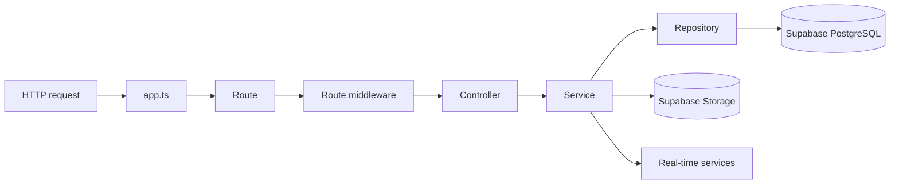
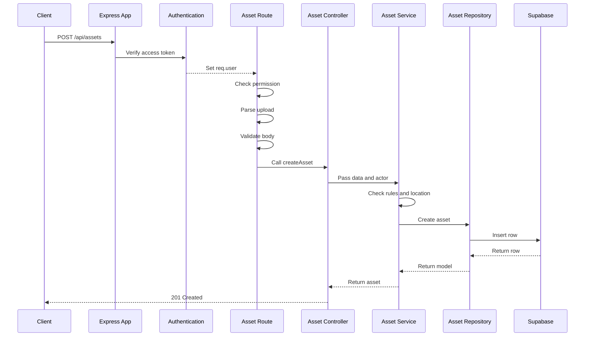

# Backend Onboarding Guide

## 1. Purpose

This tutorial helps a new developer make a safe backend change.
Complete the sections in the specified order.

The runnable application is in `backend/`.
This directory is also the Git repository root.
Run all Git and npm commands from this directory.

## 2. First-day setup

### 2.1 Check the required software

Install these tools:

- Node.js 20
- npm
- Git
- Access to the project Supabase instance

The Docker image uses Node.js 20.
Use the same major version for local work when possible.

### 2.2 Install the packages

From the outer workspace, go to the application:

```bash
cd backend
```

Install the locked package versions:

```bash
npm ci
```

### 2.3 Configure the environment

Create the local environment file:

```bash
cp .env.example .env
```

Set these required development values:

```env
NODE_ENV=development
PORT=5000
SUPABASE_URL=https://your-project.supabase.co
SUPABASE_SERVICE_ROLE_KEY=your-service-role-key
JWT_SECRET=use-a-long-random-secret
FRONTEND_URL=http://localhost:5173
```

Never commit `.env`.
Never put a real secret in `.env.example`.

The startup process checks the Supabase connection.
It checks the configured storage buckets when the key permits this check.
Startup stops when the required connection data is missing.

### 2.4 Start the service

Run the development server:

```bash
npm run dev
```

Check the health endpoint:

```bash
curl http://localhost:5000/health
```

Open the API documentation:

```text
http://localhost:5000/api/docs
```

Swagger UI is available outside production only.

### 2.5 Run the tests

Run the complete test suite:

```bash
npm test
```

The package has no lint command.
Run `npm run typecheck` to check types in `src/` and `test/`.
Run `npm run build` to compile to `dist/`; `npm start` runs the compiled output.

## 3. System architecture

The backend is one Express service.
It supplies a REST application programming interface (API).



Most table operations use this flow:

```text
route → controller → service → repository → model → response
```

The model maps `snake_case` database rows to `camelCase` objects.
Storage services use the Supabase Storage client directly.
Real-time services use the Supabase Realtime client directly.

## 4. Key entry points

| File or directory | Function |
|---|---|
| `src/server.ts` | Starts and stops the process |
| `src/app.ts` | Creates Express and mounts routes |
| `src/config/index.ts` | Reads environment configuration |
| `src/config/startup.ts` | Starts database, storage, real-time, and scheduled services |
| `src/config/supabase.ts` | Creates the Supabase client |
| `src/config/rbac.ts` | Defines roles and permissions |
| `src/routes/` | Defines URL paths and middleware |
| `src/controllers/` | Converts HTTP data to service arguments |
| `src/services/` | Applies business rules |
| `src/repositories/` | Reads and writes database tables |
| `src/models/` | Maps database rows |
| `src/validators/` | Defines Joi request schemas |
| `src/middleware/` | Applies shared HTTP controls |
| `src/docs/swagger/` | Defines the OpenAPI contract |
| `test/unit/` | Contains isolated tests |
| `test/integration/routes/` | Contains route tests |

## 5. Request lifecycle

Use `POST /api/assets` as an example.



The application processes the request in these stages:

1. `app.ts` applies global middleware.
2. `assetRouter.ts` applies `requireAuth`.
3. `assets.ts` applies `authorize`.
4. Multer parses the uploaded files.
5. Joi validates the request body.
6. `assetController.ts` passes data to the service.
7. `assetService.ts` applies business and location rules.
8. `assetRepository.ts` writes the database row.
9. The model maps the returned row.
10. The controller sends the response.

`wrapAsync` sends rejected promises to the error handler.
The error handler creates the final error response.

## 6. Authentication and access control

The authentication middleware verifies the access token.
It creates `req.user` from the verified token payload.

```js
{
  userId: 58,
  role: "admin",
  allowedLocationIds: [21, 22]
}
```

The route passes `req.user` to the controller.
The controller passes the actor to the service.
Do not pass the raw token to a service.

The backend supports these roles:

| Role | Data scope |
|---|---|
| `admin` | Assigned locations only |
| `super_admin` | All locations |

The `authorize` middleware checks the requested action.
The permission matrix is in `src/config/rbac.ts`.

Services use location helpers for location-owned data.
Repositories apply the result with `applyLocationScope`.

The scope values have different meanings:

| Value | Meaning |
|---|---|
| `null` | No location filter for a super admin |
| `[21, 22]` | Permit locations 21 and 22 |
| `[]` | Permit no rows for an unassigned admin |

Do not change an empty array to `null`.
That change can expose all location data.

Read [Authentication Module](AUTHENTICATION_MODULE.md) for the token lifecycle.

## 7. Code conventions

Use these conventions in new code:

- Write TypeScript. Keep `.js` in import paths (`from "./x.js"`); the compiler resolves them to the `.ts` files.
- Type a service method's actor as `Actor` and its request body with the input interface exported next to the Joi schema in `src/validators/`.
- Read the actor and uploaded files in controllers with `getActor(req)` and `getUploadedFiles(req)` from `src/middleware/requestContext.ts`.
- Use two spaces for indentation.
- Use semicolons.
- Use double quotation marks in JavaScript.
- Use `camelCase` for file names.
- Use `PascalCase` for service and repository classes.
- Use `async` and `await` for asynchronous work.
- Keep controllers focused on HTTP data.
- Put business rules in services.
- Put table access in repositories.
- Map rows through models.
- Throw an error from the `AppError` hierarchy.
- Wrap controller functions with `wrapAsync`.

Check the existing file before you copy a method signature.
Actor argument positions are not uniform across all services.

Some repositories use explicit column lists.
Other repositories use `select("*")`.
Follow the pattern in the repository that you change.

## 8. Add or change an endpoint

Complete these steps for a normal resource endpoint.

### 8.1 Find the complete request path

Start at the route.
Trace the controller, service, repository, and model.
Read all callers before you change a shared function.

### 8.2 Update the request schema

Add body schemas to `src/validators/`.
Use `validate(schema)` for request bodies.
Use `validateQuery(schema)` for query parameters.

Joi removes unknown fields.
The middleware replaces the original request value.

### 8.3 Update the repository

Keep table reads and writes in the repository.
Call `unwrapRepositoryError` after each Supabase query.
Return model objects instead of raw rows.

Apply `applyLocationScope` to location-owned queries.
Apply the filter before the query executes.

### 8.4 Update the service

Put normalization and business rules in the service.
Check role permission when the service pattern requires it.
Check each explicit location identifier.
Build a location scope for reads and row mutations.

For versioned data, parse the expected `version`.
Use the existing optimistic-locking repository pattern.

### 8.5 Update the controller and route

Keep the controller small.
Pass only the required values to the service.

Add authentication before protected route handlers.
Add `authorize(resource, action)` before the controller.
Add upload middleware before body validation when files are present.

### 8.6 Update the permission matrix

Add a resource to `src/config/rbac.ts` when necessary.
Define actions for both roles.
Use `manage` only when the role permits every action.

### 8.7 Update the API contract

Edit the applicable file in `src/docs/swagger/paths/`.
Add the path reference to `src/docs/swagger/openapi.yaml`.
Use the existing response schemas when possible.

### 8.8 Add tests

Add a unit test for new business logic.
Mock the repository in a service unit test.

Add a route integration test for the HTTP contract.
Mock the service in a route integration test.

Test these controls when they apply:

- Missing authentication
- Denied role permission
- Invalid request data
- Location outside the actor scope
- Stale version
- Successful response

## 9. Change database behavior

The package has no automatic migration command.
The local `migrations/` directory can contain SQL change files.
The Git rules currently ignore SQL files.

Coordinate each schema change with the database owner.
Apply approved SQL to the correct Supabase environment.

Update all affected application layers:

1. Update the model mapping.
2. Update repository columns and queries.
3. Update service rules.
4. Update Joi schemas.
5. Update the OpenAPI contract.
6. Update tests.

Do not assume that a local SQL file exists in a fresh clone.

## 10. Test and debug a change

### 10.1 Select the smallest useful test

Use a unit test for one service or helper:

```bash
npx vitest run test/unit/services/assetLoan.service.test.ts
```

Use a route test for an HTTP contract:

```bash
npm run test:routes
```

Run all tests before handoff:

```bash
npm test
```

### 10.2 Trace a failed request

Use this order:

1. Confirm the route and HTTP method.
2. Confirm the middleware order.
3. Check the validated request value.
4. Check the controller arguments.
5. Check service authorization and rules.
6. Check the repository filters.
7. Check the Supabase error.
8. Check the final error response.

Development error responses include a stack.
Production responses hide unknown error details.

### 10.3 Check startup failures

Start at `src/server.ts`.
Then read `src/config/startup.ts`.

Check these common causes:

- Missing Supabase credentials
- Invalid Supabase permissions
- Missing `JWT_SECRET`
- Storage bucket configuration
- Invalid production `FRONTEND_URL`
- Real-time startup failure

## 11. Common mistakes

Avoid these mistakes:

- Do not put business logic in a controller.
- Do not query a table from a controller.
- Do not trust a client location identifier.
- Do not treat an empty location scope as global access.
- Do not filter protected rows after retrieval.
- Do not omit `version` from a versioned update.
- Do not return raw Supabase rows.
- Do not add an endpoint without an OpenAPI update.
- Do not assume each service repeats the route permission check.
- Do not add authentication to the public loan-share route.
- Do not commit `.env` or tokens.

## 12. Commands

| Task | Command |
|---|---|
| Start development mode | `npm run dev` |
| Start the server | `npm start` |
| Run all tests | `npm test` |
| Run unit tests | `npm run test:unit` |
| Run integration tests | `npm run test:integration` |
| Run route tests | `npm run test:routes` |
| Run authentication route tests | `npm run test:auth` |
| Start test watch mode | `npm run twatch` |

## 13. Module reference

Use one module document for a focused feature change.

| Module | Document |
|---|---|
| Authentication | [Authentication Module](AUTHENTICATION_MODULE.md) |
| Authorization | [Authorization Module](AUTHORIZATION_MODULE.md) |
| Location scope | [Location Scope Module](LOCATION_SCOPE_MODULE.md) |
| User | [User Module](USER_MODULE.md) |
| Location | [Location Module](LOCATION_MODULE.md) |
| Profile | [Profile Module](PROFILE_MODULE.md) |
| Asset | [Asset Module](ASSET_MODULE.md) |
| Asset type | [Asset Type Module](ASSET_TYPE_MODULE.md) |
| Asset type field | [Asset Type Field Module](ASSET_TYPE_FIELD_MODULE.md) |
| Asset specification value | [Asset Specification Value Module](ASSET_SPECIFICATION_VALUE_MODULE.md) |
| Product | [Product Module](PRODUCT_MODULE.md) |
| File | [File Module](FILE_MODULE.md) |
| Storage | [Storage Module](STORAGE_MODULE.md) |
| Software license | [Software License Module](SOFTWARE_LICENSE_MODULE.md) |
| Asset loan | [Asset Loan Module](ASSET_LOAN_MODULE.md) |
| Dashboard | [Dashboard Module](DASHBOARD_MODULE.md) |
| Search | [Search Module](SEARCH_MODULE.md) |
| Realtime | [Realtime Module](REALTIME_MODULE.md) |
| HTTP cache | [HTTP Cache Module](HTTP_CACHE_MODULE.md) |
| Overdue loan scheduler | [Overdue Loan Scheduler Module](OVERDUE_LOAN_SCHEDULER_MODULE.md) |

## 14. Recommended reading order

Read these files before your first large change:

1. [`README.md`](../../../README.md)
2. [`src/app.ts`](../../app.ts)
3. [`src/server.ts`](../../server.ts)
4. [`src/config/index.ts`](../../config/index.ts)
5. [`src/middleware/rbac.ts`](../../middleware/rbac.ts)
6. [`src/utils/locationScope.ts`](../../utils/locationScope.ts)
7. [`src/repositories/repositoryHelpers.ts`](../../repositories/repositoryHelpers.ts)
8. One complete route-to-repository flow
9. [`AUTHENTICATION_MODULE.md`](AUTHENTICATION_MODULE.md)

Use the asset module for the first complete flow:

```text
src/routes/assets.ts
→ src/controllers/assetController.ts
→ src/services/assetService.ts
→ src/repositories/assetRepository.ts
→ src/models/assetModel.ts
```
