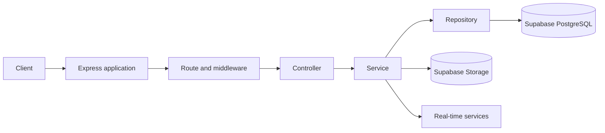

# IT Asset Inventory Backend

This service manages IT assets for multiple locations.
It supplies a REST API for administrators and system integrations.

The service manages these resources:

- Users and locations
- Profiles and asset assignments
- Asset types, products, and specifications
- Assets and image albums
- Files and resource links
- Software licenses
- Asset loans and extensions
- Dashboard data and search results
- Real-time server events

## Architecture

The service is a Node.js application with an Express API, written in TypeScript.
It uses Supabase for PostgreSQL data, object storage, and real-time events.



Most database requests use this flow:

```text
route → controller → service → repository → Supabase
```

Routes select middleware and handlers.
Controllers translate HTTP data.
Services apply business and access rules.
Repositories own table queries.
Models map database rows to application objects.

Storage and real-time services use the Supabase client directly.

## Technology

| Area | Technology |
|---|---|
| Runtime | Node.js 20 in the Docker image |
| Language | TypeScript (strict), compiled to `dist/` with `tsc` |
| Module format | Native ECMAScript modules (`.js` import suffixes) |
| HTTP API | Express 4 |
| Database | Supabase PostgreSQL |
| Validation | Joi |
| Authentication | JSON Web Tokens and refresh cookies |
| Password hashing | Argon2 |
| Uploads | Multer and Supabase Storage |
| Real-time delivery | Supabase Realtime and server-sent events |
| Scheduled work | node-cron |
| Tests | Vitest and Supertest |
| API specification | OpenAPI and Swagger UI |

## Quick start

Run all commands from this `backend/` directory.

### 1. Install dependencies

```bash
npm ci
```

### 2. Create the environment file

```bash
cp .env.example .env
```

Set these values before startup:

```env
NODE_ENV=development
PORT=5000
SUPABASE_URL=https://your-project.supabase.co
SUPABASE_SERVICE_ROLE_KEY=your-service-role-key
JWT_SECRET=use-a-long-random-secret
FRONTEND_URL=http://localhost:5173
```

You can use `SUPABASE_KEY` when a service-role key is not available.
The key must permit the startup database check.

The startup process connects to Supabase.
It checks the configured storage buckets when the key permits this check.
Use a database that contains the required project schema.

### 3. Start the development server

```bash
npm run dev
```

The development server runs the TypeScript source with `tsx` and restarts on change.

### 4. Check the service

```bash
curl http://localhost:5000/health
```

The default response has this form:

```json
{
  "status": "ok",
  "timestamp": "2026-07-27T00:00:00.000Z"
}
```

Use these local URLs:

| Function | URL |
|---|---|
| Health check | `http://localhost:5000/health` |
| Swagger UI | `http://localhost:5000/api/docs` |
| OpenAPI JSON | `http://localhost:5000/api/docs/openapi.json` |

The API documentation is not available in production mode.

## Commands

| Task | Command |
|---|---|
| Start development mode | `npm run dev` |
| Compile to `dist/` | `npm run build` |
| Start the compiled server | `npm start` |
| Type-check without emitting | `npm run typecheck` |
| Run all tests | `npm test` |
| Run unit tests | `npm run test:unit` |
| Run integration tests | `npm run test:integration` |
| Run route tests | `npm run test:routes` |
| Run authentication route tests | `npm run test:auth` |
| Start test watch mode | `npm run twatch` |

These aliases are also available:

| Alias | Full command |
|---|---|
| `npm run t` | `npm run test` |
| `npm run tu` | `npm run test:unit` |
| `npm run ti` | `npm run test:integration` |
| `npm run tauth` | `npm run test:auth` |

The package has no lint script.
`npm start` runs `dist/server.js`, so run `npm run build` first.
The package has no database migration command.

## API areas

| Area | Base path | Main function |
|---|---|---|
| Authentication | `/api/auth` | Login, refresh, logout, and password reset |
| Users | `/api/users` | User management and self-service |
| Locations | `/api/locations` | Location management |
| Profiles | `/api/profiles` | Assignee and contact records |
| Assets | `/api/assets` | Asset inventory and classification |
| Files | `/api/files` | File albums and resource links |
| Licenses | `/api/licenses` | Software license inventory |
| Loans | `/api/loans` | Asset loan workflows |
| Dashboard | `/api/dashboard` | Summary data |
| Search | `/api/search` | Location-scoped search |
| Real-time | `/api/realtime` | Server-sent event stream |

The loan module also has a public share route.
All authentication routes are public by design.
Other business routes require an access token.

## Access control

The backend supports `admin` and `super_admin`.
The role-based access control matrix defines the permitted actions.

An `admin` can use data from assigned locations only.
A `super_admin` can use data from all locations.

The access token supplies the actor to protected routes.
Services check access to explicit location identifiers.
Repositories apply location filters to database queries.

Do not filter protected data after a database query.
Apply the location scope in the repository query.

See [Authentication Module](src/docs/markdown/AUTHENTICATION_MODULE.md) for the token lifecycle.

## Request processing

The application uses this middleware order:

1. Helmet sets security headers.
2. CORS checks the request origin.
3. Express parses the request body.
4. Cookie Parser reads cookies.
5. Morgan writes request logs.
6. The global limiter checks the request rate.
7. Route middleware authenticates and authorizes the actor.
8. Joi validates the request data.
9. The controller calls the service.
10. The error handler formats failures.

Joi removes fields that are not in the selected schema.
The service receives the validated value.

## Project structure

```text
backend/
├── src/
│   ├── config/          Runtime configuration and startup
│   ├── controllers/     HTTP adapters
│   ├── docs/            OpenAPI source and onboarding
│   ├── middleware/      Authentication, validation, uploads, and errors
│   ├── models/          Database row mappings
│   ├── repositories/    Table queries
│   ├── routes/          Endpoint definitions
│   ├── services/        Business rules and external services
│   ├── utils/           Shared functions and error types
│   ├── validators/      Joi schemas
│   ├── types/           Shared types (Actor, LocationScope) and Express augmentation
│   ├── app.ts           Express application
│   └── server.ts        Process entry point
├── test/
│   ├── integration/     Route integration tests
│   └── unit/            Unit tests
├── .env.example
├── Dockerfile
├── package.json
├── tsconfig.json        Type checking for src and test
├── tsconfig.build.json  Build for src only, output in dist/
└── vitest.config.ts
```

## Testing

Unit tests isolate services, models, middleware, and utilities.
They usually replace repositories with mocks.

Route integration tests use the real Express application.
They usually replace the service layer with mocks.

Run one test file with this command:

```bash
npx vitest run test/unit/services/auth.service.test.ts
```

Run one named test with this command:

```bash
npx vitest run -t "should reject stale version"
```

## Production notes

Production startup requires these settings:

- `JWT_SECRET`
- `SUPABASE_URL`
- `SUPABASE_SERVICE_ROLE_KEY` or `SUPABASE_KEY`
- `FRONTEND_URL`

Production startup rejects a localhost frontend URL.
Production refresh cookies use secure transport by default.

The server handles `SIGINT` and `SIGTERM`.
It stops scheduled work and real-time subscriptions.
It then closes the HTTP server.

The Docker image uses Node.js 20.
It builds the TypeScript in one stage and copies only `dist/` into the runtime stage.
The runtime stage installs production dependencies only.
It runs the process as the `node` user.

## Documentation

| Document | Purpose |
|---|---|
| [Onboarding Guide](src/docs/markdown/ONBOARDING.md) | Start work in the codebase |
| [OpenAPI source](src/docs/swagger/openapi.yaml) | Review the API contract |

Start with the onboarding guide when you make your first change.

### Module reference

| Module | Document |
|---|---|
| Authentication | [Authentication Module](src/docs/markdown/AUTHENTICATION_MODULE.md) |
| Authorization | [Authorization Module](src/docs/markdown/AUTHORIZATION_MODULE.md) |
| Location scope | [Location Scope Module](src/docs/markdown/LOCATION_SCOPE_MODULE.md) |
| User | [User Module](src/docs/markdown/USER_MODULE.md) |
| Location | [Location Module](src/docs/markdown/LOCATION_MODULE.md) |
| Profile | [Profile Module](src/docs/markdown/PROFILE_MODULE.md) |
| Asset | [Asset Module](src/docs/markdown/ASSET_MODULE.md) |
| Asset type | [Asset Type Module](src/docs/markdown/ASSET_TYPE_MODULE.md) |
| Asset type field | [Asset Type Field Module](src/docs/markdown/ASSET_TYPE_FIELD_MODULE.md) |
| Asset specification value | [Asset Specification Value Module](src/docs/markdown/ASSET_SPECIFICATION_VALUE_MODULE.md) |
| Product | [Product Module](src/docs/markdown/PRODUCT_MODULE.md) |
| File | [File Module](src/docs/markdown/FILE_MODULE.md) |
| Storage | [Storage Module](src/docs/markdown/STORAGE_MODULE.md) |
| Software license | [Software License Module](src/docs/markdown/SOFTWARE_LICENSE_MODULE.md) |
| Asset loan | [Asset Loan Module](src/docs/markdown/ASSET_LOAN_MODULE.md) |
| Dashboard | [Dashboard Module](src/docs/markdown/DASHBOARD_MODULE.md) |
| Search | [Search Module](src/docs/markdown/SEARCH_MODULE.md) |
| Realtime | [Realtime Module](src/docs/markdown/REALTIME_MODULE.md) |
| HTTP cache | [HTTP Cache Module](src/docs/markdown/HTTP_CACHE_MODULE.md) |
| Overdue loan scheduler | [Overdue Loan Scheduler Module](src/docs/markdown/OVERDUE_LOAN_SCHEDULER_MODULE.md) |
